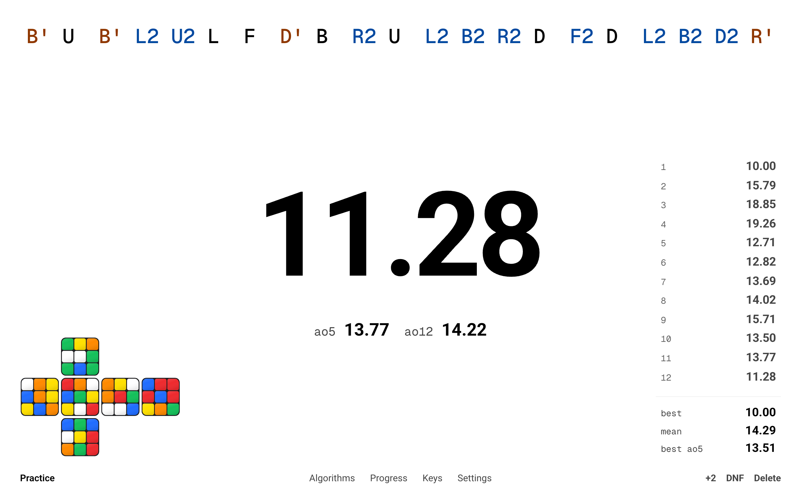
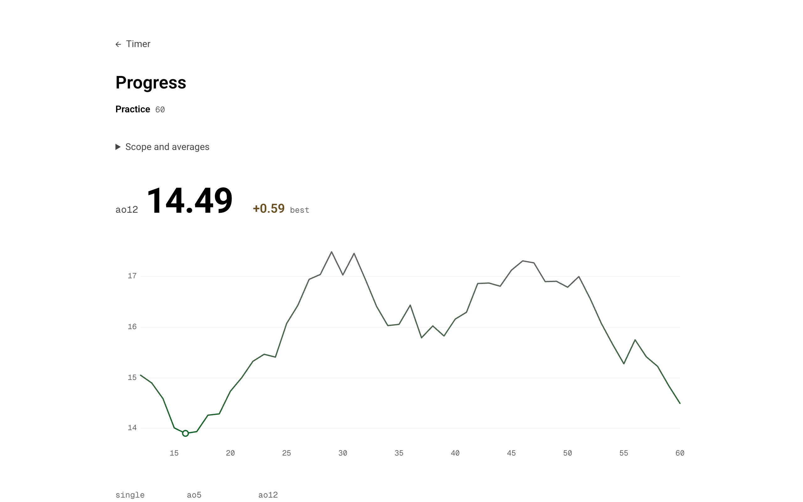

<p align="center">
  
</p>

<h1 align="center">cubehaus</h1>

<p align="center">
  A speedcubing timer for the browser.<br>
  <a href="https://cubehaus.imslide.workers.dev"><b>Open the timer</b></a>
</p>

<picture>
  <source media="(prefers-color-scheme: dark)" srcset=".github/timer-dark.png">
  
</picture>

I got tired of timers that feel dated, like csTimer, and of good ones that are no longer maintained. So I am building my own, first of all for myself.

It is free and always will be. Use it if you like it. If something is missing or gets in your way, [tell me](https://github.com/sa1ntsinner/cubehaus/issues/new/choose): I read every idea and will try to build the good ones.

## What is in it

- Every WCA event, with official scrambles, inspection, +2 and DNF.
- Sessions, averages from ao5 to ao10000, and a progress view.
- Your history from csTimer, CubeTime, Twisty Timer and CubeDesk, imported without duplicates.
- An algorithm trainer for the 3×3 and 2×2, drill scrambles, and training for starting on any cross colour.
- Works offline, needs no account, keeps your solves on your device.
- Keyboard first. Dark, light and custom themes. English and Russian.

<picture>
  <source media="(prefers-color-scheme: dark)" srcset=".github/progress-dark.png">
  
</picture>

## Run it

Node 26 and pnpm 12.18.0.

```sh
pnpm install
pnpm --filter @cubehaus/web dev
```

## Help

- **An idea or a bug:** [open an issue](https://github.com/sa1ntsinner/cubehaus/issues/new/choose). A sentence is enough.
- **Code:** see [CONTRIBUTING.md](CONTRIBUTING.md).

## Licence

[MPL-2.0](LICENSE). Scrambles come from [cubing.js](https://github.com/cubing/cubing.js).
